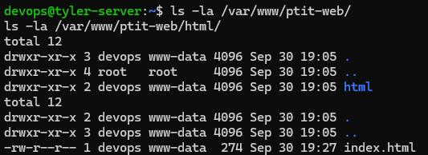
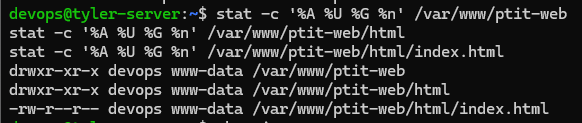
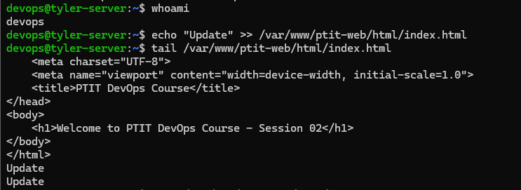
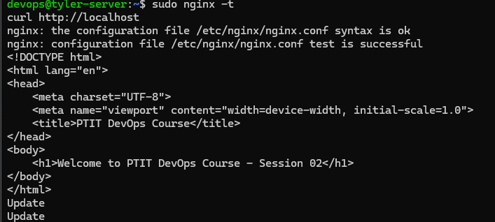

# Exe5 - Directory Permission Management

## 1. Mục tiêu

Thiết lập quyền sở hữu và quyền truy cập cho thư mục website `/var/www/ptit-web/`.

Mục tiêu là cho phép user `devops` chỉnh sửa mã nguồn website mà không cần sử dụng `sudo`, đồng thời Nginx chạy dưới user `www-data` vẫn có thể đọc và phục vụ website.

## 2. Môi trường

| Thành phần        | Thông tin               |
| ----------------- | ----------------------- |
| Server            | Personal Ubuntu Server  |
| OS                | Ubuntu Server 24.04 LTS |
| Web Server        | Nginx                   |
| Website directory | `/var/www/ptit-web/`    |
| Website owner     | `devops`                |
| Website group     | `www-data`              |

## 3. Thay đổi ownership

Thay đổi owner thành `devops` và group thành `www-data`:

```bash
sudo chown -R devops:www-data /var/www/ptit-web
```



## 4. Thiết lập quyền cho thư mục

Các thư mục được thiết lập permission `755`:

```bash
sudo find /var/www/ptit-web -type d -exec chmod 755 {} \;
```

Permission:

```text
Owner  → Read + Write + Execute
Group  → Read + Execute
Others → Read + Execute
```

## 5. Thiết lập quyền cho file

Các file được thiết lập permission `644`:

```bash
sudo find /var/www/ptit-web -type f -exec chmod 644 {} \;
```

Permission:

```text
Owner  → Read + Write
Group  → Read
Others → Read
```



## 6. Kiểm tra user devops có quyền ghi

Kiểm tra user:

```bash
whoami
```

Kết quả:

```text
devops
```

Thực hiện ghi file không sử dụng `sudo`:

```bash
echo "Update" >> /var/www/ptit-web/html/index.html
```

Kiểm tra nội dung:

```bash
tail /var/www/ptit-web/html/index.html
```

File được cập nhật thành công.



## 7. Kiểm tra Nginx

Kiểm tra cấu hình:

```bash
sudo nginx -t
```

Kết quả:

```text
syntax is ok
test is successful
```

Reload Nginx:

```bash
sudo systemctl reload nginx
```

Kiểm tra website:

```bash
curl http://localhost
```

Website cũng được kiểm tra bằng trình duyệt thông qua địa chỉ IP/Tailscale IP của server.



## 8. Kết quả

Sau khi cấu hình:

* `devops` là owner của `/var/www/ptit-web/`.
* `www-data` là group của thư mục.
* `devops` có quyền đọc và ghi mã nguồn.
* `www-data` có quyền đọc để Nginx phục vụ website.
* User khác không có quyền ghi vào website.
* Nginx vẫn hoạt động bình thường và không trả về lỗi `403 Forbidden`.
